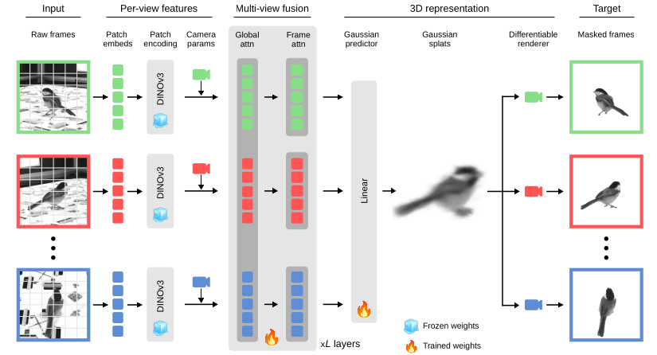

<div align="center">

# BEAST & BEAST3D

**Self-supervised vision transformers for animal behavioral analysis and neural encoding**

**Be**havioral **a**nalysis via **s**elf-supervised pretraining of **t**ransformers

[](https://openreview.net/forum?id=AeqPIRKUni)
[](https://arxiv.org/abs/2507.09513)
[](https://arxiv.org/abs/2606.02937)
[](https://arxiv.org/abs/2606.02937)
[](https://ppwangyc.github.io/projects/beast3d)

[](https://pypi.org/project/beast-backbones/)
[](https://codecov.io/gh/paninski-lab/beast)
[](LICENSE)

</div>

`beast` is the official code for **BEAST** (ICLR 2026) and **BEAST3D** (NeurIPS 2026, Oral).
Both pretrain vision transformers on *unlabeled* video from your own experiments, producing
backbones for downstream tasks such as pose estimation, action segmentation, and neural encoding.

* **BEAST** works on **single-view** video. Each camera view is treated as an independent image
  stream, and a ViT is pretrained with masked autoencoding plus an optional temporal contrastive
  loss.
* **BEAST3D** works on **synchronized, calibrated multi-view** video. A transformer predicts
  3D Gaussian splats from a subset of camera views, renders the held-out views through
  differentiable rendering, and learns to segment the animal from the background at the same time.
  Because it conditions on the known camera calibration, it reconstructs 3D structure from as few
  as four cameras.

<p align="center">
  
</p>
<p align="center">
  <em>BEAST3D overview. Frozen DINOv3 features and known camera parameters from each input view are
  fused by a multi-view transformer, which predicts 3D Gaussian splats that are rendered into the
  target views and compared with the masked frames.</em>
</p>

## News

* **[2026/10]** BEAST3D is accepted as an **Oral** at NeurIPS 2026!
  [[Paper](https://arxiv.org/abs/2606.02937)] [[Project page](https://ppwangyc.github.io/projects/beast3d)]
* **[2026/06]** BEAST3D preprint is on [arXiv](https://arxiv.org/abs/2606.02937), and the code is
  in this repo: the `beast3d` model, the `beast extract_3d` multi-view data pipeline, and an
  E-RayZer baseline.
* **[2026/02]** Camera-ready version of the BEAST paper (ICLR 2026) is on
  [arXiv](https://arxiv.org/abs/2507.09513).
* **[2025/07]** BEAST preprint is on [arXiv](https://arxiv.org/abs/2507.09513), and
  `beast-backbones` is on [PyPI](https://pypi.org/project/beast-backbones/).

## Contents

* [Which model should I use?](#which-model-should-i-use)
* [Installation](#installation)
* [Quick start: BEAST (single-view)](#quick-start-beast-single-view)
* [Quick start: BEAST3D (multi-view)](#quick-start-beast3d-multi-view)
* [Documentation](#documentation)
* [Citation](#citation)
* [Acknowledgements](#acknowledgements)
* [Contributing](#contributing)
* [Funding](#funding)

## Which model should I use?

|                     | **BEAST**                                                    | **BEAST3D**                                                                 |
|---------------------|--------------------------------------------------------------|-----------------------------------------------------------------------------|
| Paper               | [ICLR 2026](https://openreview.net/forum?id=AeqPIRKUni)      | [NeurIPS 2026 (Oral)](https://arxiv.org/abs/2606.02937) · [project page](https://ppwangyc.github.io/projects/beast3d) |
| Input video         | single view (cameras are processed independently)            | synchronized multi-view, with camera calibration (anipose `.toml`)          |
| Pretraining         | masked autoencoding (+ optional temporal contrastive loss)   | render held-out views from predicted 3D Gaussian splats + foreground segmentation |
| Backbone            | ViT-B/16 (`vit`) or ResNet autoencoder (`resnet`)            | frozen DINOv3 ViT-B/16 + multi-view transformer (`beast3d`)                 |
| Tasks in the paper  | pose estimation, action segmentation, neural encoding        | novel view synthesis, multi-view pose estimation, neural encoding          |
| Example config      | [`configs/vit.yaml`](configs/vit.yaml)                        | [`configs/multiview/beast3d.yaml`](configs/multiview/beast3d.yaml)          |

**Rule of thumb:** one camera, or cameras without calibration → BEAST.
A calibrated rig of synchronized cameras (four or more) → BEAST3D.

## Installation

**1. Install ffmpeg.** Check whether it is already installed, and install it if not:

```bash
ffmpeg -version
sudo apt install ffmpeg
```

**2. Create a conda environment** (first [install anaconda](https://docs.anaconda.com/free/anaconda/install/index.html)):

```bash
conda create --yes --name beast python=3.10
conda activate beast
```

**3. Install `beast`** from source (recommended; BEAST3D was added after the latest PyPI release,
so it is only available from source for now):

```bash
git clone https://github.com/paninski-lab/beast
cd beast
pip install lightning poetry-core
pip install -e . --no-build-isolation
```

or from PyPI:

```bash
pip install lightning poetry-core
pip install beast-backbones --no-build-isolation
```

> [!NOTE]
> `beast` depends on a custom fork of [gsplat](https://github.com/QitaoZhao/gsplat) that must be
> compiled from source. The `gsplat` build requires `torch` (provided by `lightning`) and the build
> backend requires `poetry-core`. Installing these first and using `--no-build-isolation` lets the
> build find them in your environment. For GPU architecture settings and troubleshooting, see the
> [BEAST3D environment guide](docs/beast3d.md#environment-setup).

Run `beast -h` to check the installation and list the available commands.

## Quick start: BEAST (single-view)

**1. Extract frames** from a directory of videos to train on:

```bash
beast extract --input <video_dir> --output <frames_dir>
```

**2. Pretrain a model.** Pass a config (see [`configs/vit.yaml`](configs/vit.yaml) and
[`configs/resnet_ae.yaml`](configs/resnet_ae.yaml)) and point it at the extracted frames:

```bash
beast train --config configs/vit.yaml --data <frames_dir> --output <model_dir>
```

**3. Run inference** on a single video, a directory of videos, or a (possibly nested) directory of
images, saving latent features and/or reconstructions:

```bash
beast predict --model <model_dir> --input <video_or_dir> --save_latents --save_reconstructions
```

Run `beast <command> -h` (e.g. `beast train -h`) for all options.

## Quick start: BEAST3D (multi-view)

BEAST3D expects synchronized videos named `<session>_<cam>.mp4` and one
[anipose](https://github.com/lambdaloop/aniposelib) calibration file (`<session>.toml`) per session.

**1. Build a multi-view dataset.** This selects frames, exports camera parameters, and generates
SAM3 foreground masks. BEAST3D training requires the masks, so keep `segmentation.enabled: true`
(this step needs a GPU):

```bash
beast extract_3d --config configs/multiview/extraction_pipeline.yaml
```

See [Extracting data for BEAST3D](docs/extract_data_for_3d.md) for the input layout and all
config options.

**2. Pretrain BEAST3D** on the `dataset/` directory produced by `beast extract_3d`:

```bash
beast train --config configs/multiview/beast3d.yaml --data <output_dir>/dataset --gpus 8
```

Before training, set the number of views and the scene depth range for your rig
(`training.num_views`, `training.num_input_views`, `training.num_target_views`, and
`model.gaussians.range_setting.far` in
[`configs/multiview/beast3d.yaml`](configs/multiview/beast3d.yaml)).
For reference, pretraining on one dataset in the paper took about 32 hours on 8 A100 GPUs.

## Documentation

| Guide | Description |
|-------|-------------|
| [BEAST3D](docs/beast3d.md) | Environment setup for BEAST3D, including building gsplat for your GPU |
| [Extracting data for BEAST3D](docs/extract_data_for_3d.md) | Turning raw multi-view videos and calibrations into a training dataset |
| [Developer guide](docs/developer_guide.md) | Package architecture and how to add a new model |

## Citation

If you find BEAST or BEAST3D useful in your research, please cite:

```bibtex
@inproceedings{wang2026beast,
  title     = {Animal behavioral analysis and neural encoding with transformer-based
               self-supervised pretraining},
  author    = {Wang, Yanchen and Yu, Han and Blau, Ari and Zhang, Yizi and
               {The International Brain Laboratory} and Paninski, Liam and
               Hurwitz, Cole Lincoln and Whiteway, Matthew R},
  booktitle = {International Conference on Learning Representations (ICLR)},
  year      = {2026},
  url       = {https://openreview.net/forum?id=AeqPIRKUni}
}

@article{wang2026beast3d,
  title   = {BEAST3D: Animal behavioral analysis and neural encoding
             from multi-view video via Gaussian splatting},
  author  = {Wang, Yanchen and Aharon, Lenny and Zhu, Wangshu and
             Daruwalla, Kyle and Zhang, Linghua and Zou, Jiaru and
             Chettih, Selmaan and Hou, Helen and Paninski, Liam and
             Whiteway, Matthew R.},
  journal = {arXiv preprint arXiv:2606.02937},
  year    = {2026}
}
```

## Acknowledgements

BEAST3D builds on [E-RayZer](https://github.com/QitaoZhao/E-RayZer) and renders with a
[fork of gsplat](https://github.com/QitaoZhao/gsplat). It uses
[DINOv3](https://github.com/facebookresearch/dinov3) image features,
[SAM 3](https://github.com/facebookresearch/sam3) foreground masks, and
[aniposelib](https://github.com/lambdaloop/aniposelib) camera calibrations.
We thank the authors of these projects for releasing their code.

## Contributing

See [CONTRIBUTING.md](CONTRIBUTING.md) for guidelines on setting up a development environment,
code style, and submitting pull requests.

## Funding

We are grateful for support from the following:
* Gatsby Charitable Foundation GAT3708
* [NIH R50NS145433](https://reporter.nih.gov/search/Hmj4KMmLv0evcYPlPEDa-Q/project-details/11240675)
* [NIH U19NS123716](https://reporter.nih.gov/search/Hmj4KMmLv0evcYPlPEDa-Q/project-details/11141703)
* [NSF 1707398](https://ui.adsabs.harvard.edu/abs/2017nsf....1707398A/abstract)
* [The NSF AI Institute for Artificial and Natural Intelligence](https://ui.adsabs.harvard.edu/abs/2023nsf....2229929Z/abstract)
* Simons Foundation
* Wellcome Trust 216324
* Zuckerman Institute (Columbia University) Team Science

## License

This project is licensed under the [MIT License](LICENSE).
